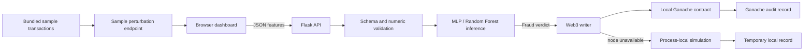

# GuardChain AI

A local demonstration of credit-card fraud classification with an audit-record workflow. The current dashboard includes a transaction analyzer and a **simulated sample feed** that replays perturbed rows from the public dataset. It is not connected to a live payment processor.

## Architecture



## Quick start (Windows)

1. Install Python 3.12 and create a virtual environment in the project directory. The pinned dependency set was installed on Windows 11 with CPU-only PyTorch.
2. In PowerShell, run `python -m venv .venv` then `.venv\Scripts\python -m pip install -r requirements.txt`.
3. Copy `.env.example` to `.env` if you want to change the local Ganache URL or Flask port.
4. Run `run.bat`; open `http://127.0.0.1:5000`.

The saved model artifacts and `static/sample_transactions.json` are used for the offline demo. Keep those files in the project root. A local Ganache node is optional: with it unavailable, the app uses a process-local simulation ledger. Simulation records are temporary, disappear when the server restarts, and do not have blockchain transaction hashes. The UI labels them separately.

## Training and evaluation

The existing root-level model files are retained as the legacy demo artifacts. The revised training scripts write new artifacts to `artifacts/phase3/` and measured results to `results/phase3/`; they do not overwrite the legacy model files. The revised protocol creates stratified 65/15/20 train/validation/test partitions, fits preprocessing on training rows only, selects the RF tree count using validation PR-AUC, chooses decision thresholds using validation F1, and evaluates once on the held-out test set.

```powershell
python train_dl_model.py
python train_model.py
python ablation.py
python evaluate.py
python -m unittest discover -s tests -v
```

Training requires the public [ULB/Kaggle credit-card fraud dataset](https://www.kaggle.com/datasets/mlg-ulb/creditcardfraud), downloaded separately as `creditcard.csv`; the 150 MB raw file is intentionally excluded from this repository due to GitHub file limits. `evaluate.py` recomputes test metrics from saved probabilities, produces confusion-matrix and ROC/precision-recall plots, writes a comparison table, and benchmarks local Flask scoring with audit writes stubbed. It does **not** measure Ganache confirmation latency. The revised run on this Windows 11 CPU-only laptop used a 56,962-row test partition with 98 fraud cases:

| Model | Accuracy | Precision | Recall | F1 | PR-AUC | Scoring p95 | Requests/s |
|---|---:|---:|---:|---:|---:|---:|---:|
| MLP (threshold 0.9798) | 99.92% | 72.17% | 84.69% | 77.93% | 0.6745 | 3.01 ms | 389.6 |
| Random Forest (threshold 0.36) | 99.96% | 94.19% | 82.65% | 88.04% | 0.8609 | 49.19 ms | 26.2 |

The unweighted-loss ablation had 81.63% recall and 81.63% precision; weighted BCE raised recall by about 3.1 percentage points but lowered precision and F1 on this split. The benchmark used Flask's in-process test client with audit writes stubbed, so throughput and latency exclude network transport and Ganache confirmation. The measurements meet the under-500-ms scoring target for this setup; they are not an end-to-end payment-service SLA. Raw outputs and plots are in `results/phase3/`. Historical JSON files in `static/` are not results from this revised protocol.

## Positioning in the Indian fraud-detection landscape

GuardChain AI is a **student-scale research and teaching demonstrator**, not an Indian banking or payment-network product. Its core combination of machine-learning fraud scoring and blockchain audit is not, by itself, unique. Publicly documented Indian systems already work at bank, telecom, payment-network, or multi-institution scale. The comparison below describes scope, not a head-to-head model benchmark.

| Publicly documented system | Publicly documented focus | Difference from this project |
|---|---|---|
| [RBIH MuleHunter.ai](https://docs.rbihub.in/mule-hunter) | ML risk scoring for suspected money-mule bank accounts, designed to integrate with bank AML/EFRM systems. RBIH documentation describes staged T+1, hourly, and near-real-time deployment. | Account/mule risk and bank-side deployment; GuardChain scores a single transaction feature vector in a local demo. |
| [RBIH Digital Payments Intelligence Platform (DPIP)](https://www.rbi.org.in/Scripts/BS_ViewBulletin.aspx?Id=22648) | RBI proposed network-level payment-fraud intelligence and data sharing; institutional descriptions discuss signals shared across participating entities. | Ecosystem intelligence across participants; GuardChain is a standalone app with no inter-bank data or integration. |
| [DoT Financial Fraud Risk Indicator (FRI)](https://www.pib.gov.in/Pressreleaseshare.aspx?PRID=2141616) | Risk tiers for mobile numbers based on stakeholder inputs, intended to help banks and UPI providers take protective actions. | Telecom-number risk context; GuardChain does not ingest phone-number or telecom signals. |
| [NPCI Fraud Risk Management (FRM)](https://www.npci.org.in/product/nfs/about-nfs) | NPCI describes real-time monitoring for the NFS network with alert or decline capability; NPCI guidance also discusses real/near-real-time bank monitoring and EFRM. | Payment-network participant controls; GuardChain provides a local prediction and an optional local Ganache audit workflow. |

These sources do not publish comparable datasets, thresholds, or complete test metrics. Therefore, GuardChain's measured precision must **not** be presented as better than any of these systems. This is a selected public-source scan, not a complete list of every Indian bank, fintech, or research project; many internal systems are not public.

### What is distinctive about GuardChain today

- It provides a compact, inspectable flow from validated feature input to model score, threshold-based verdict, timing, and audit-write status.
- It compares an MLP and Random Forest on the same fixed held-out split and publishes precision, recall, F1, PR-AUC, ROC-AUC, and confusion matrices.
- It explicitly distinguishes a confirmed local Ganache receipt from a temporary in-memory simulation record.
- Its bundled sample replay provides a repeatable classroom/tech-fest demonstration without a live payment gateway.

These are implementation and evaluation contributions, **not a claim of a novel fraud algorithm or production-grade Indian payment protection**. Current limitations include European historical training data (not Indian UPI/card transactions), no live payment feed, no mule/device/phone graph, no production bank integration, and local-chain-only audit demonstration. The latency benchmark excludes browser/network and Ganache confirmation time. See [the evaluation artifacts](results/phase3/) and [the paper draft](paper/main.tex).

## API

- `POST /predict`: JSON body `{ "features": {"Time": 0, "Amount": 12.5, "V1": 0, ...}, "model_type": "dl" }`. Provide the complete feature set shown by the analyzer. Response includes probability, selected threshold, inference/scoring/total response timing, and ledger mode.
- `GET /api/samples`: bundled sample rows.
- `GET /api/generate_simulated`: one perturbed dataset example for the demo simulator.
- `GET /api/blockchain_logs`: current Ganache entries or local process-only simulation entries.
- `POST /api/update_status`: update a record status in the active ledger mode.
- `GET /api/network_status`: local node and saved model metric status.

The server binds to `127.0.0.1` by default. There is no authentication or multi-user access control; do not expose this demo server to a public network or send real cardholder data to it. Do not put personal identifiers or sensitive transaction details on a blockchain.

## Known limitations

- The included transaction feed is simulated from historical samples. There is no live issuer, gateway, WebSocket, or event-stream integration.
- Ganache is a local development chain. When unavailable, writes go to volatile in-memory state. A simulation receipt is never an on-chain receipt.
- Revised metrics and timing measurements from the recorded run are committed under `results/phase3/`; they apply only to the documented held-out split and in-process benchmark.
- The current legacy model results are historical and were produced by preprocessing fitted before the train/test split. Use the revised training/evaluation commands for research claims.
- `test_integration.py` expects a separately running server. The `tests/` suite uses Flask's in-process client.

## Screenshots

Screenshots are not included yet. Add genuine captures after launching the app on the target demo machine; do not use mock UI images as evidence of a successful run.


